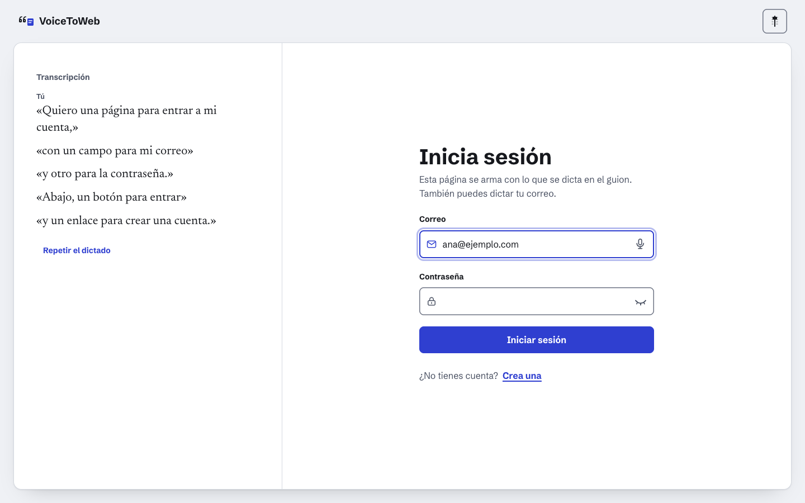
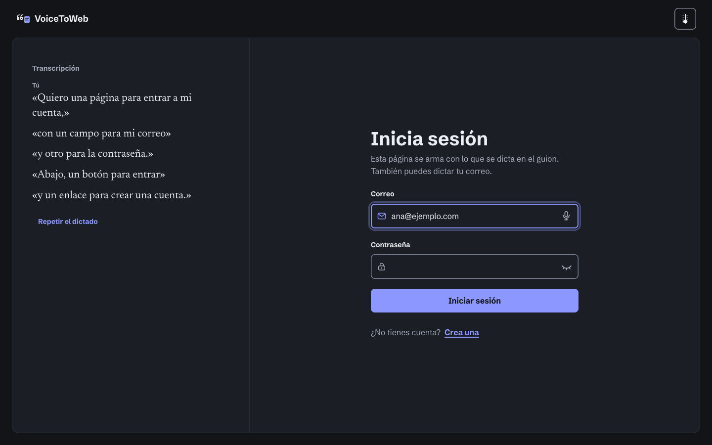
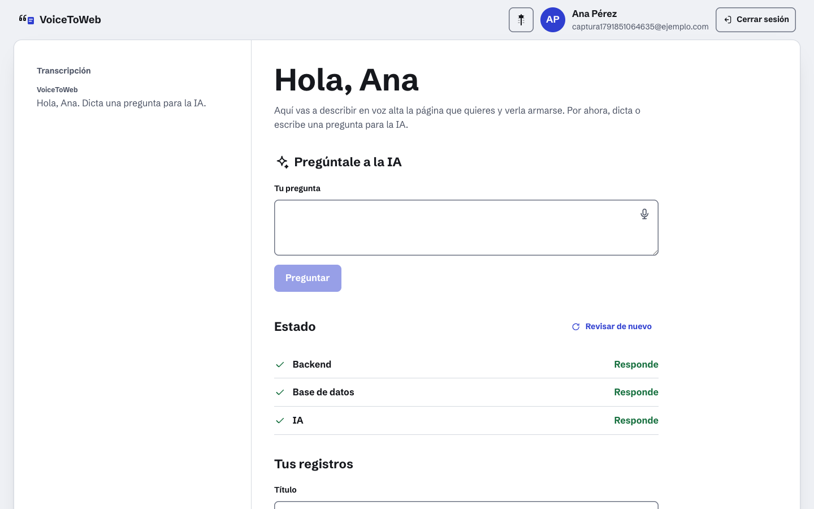
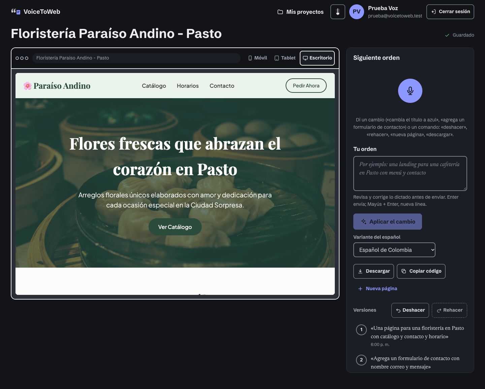
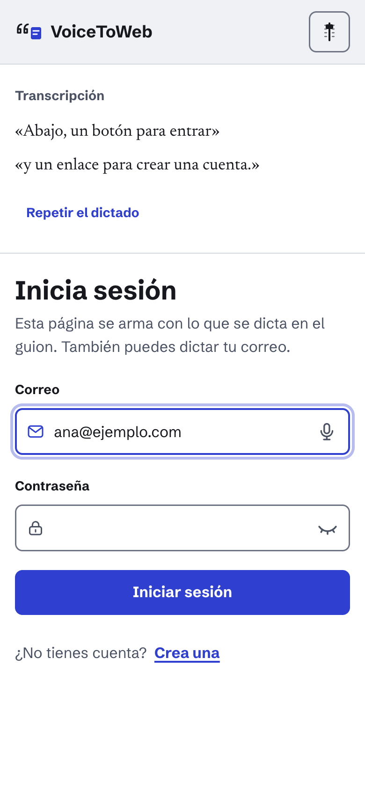
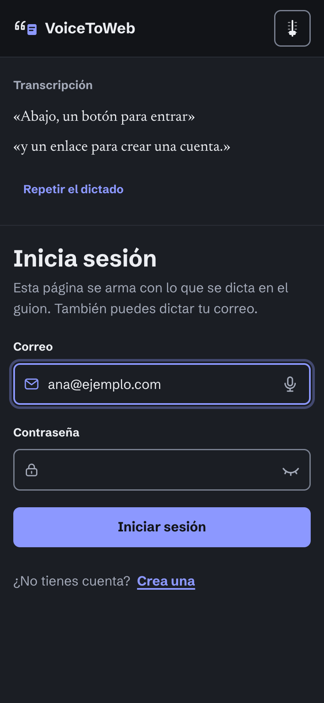
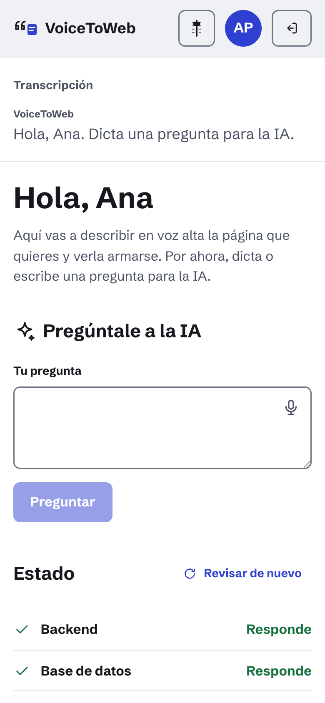
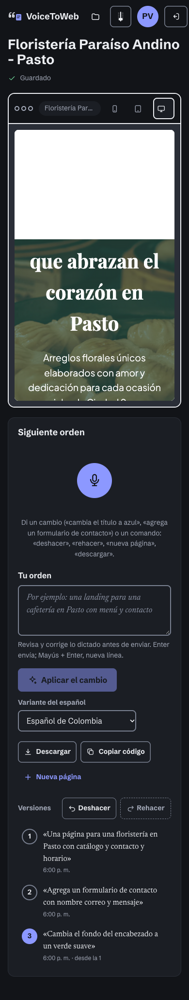

# VoiceToWeb · Frontend

**VoiceToWeb** es una herramienta de prototipado web por voz: describes en voz alta la página que quieres, la IA genera el HTML y CSS y lo muestra en vivo, y nuevas órdenes ("cambia el título a azul", "agrega un formulario de contacto") la modifican. Usa la Web Speech API del navegador, siempre con alternativa de teclado.

Proyecto 3 de la materia Programación orientada a la web. Angular 22 (standalone, signals, sin SSR, CSS plano).

Backend: <https://github.com/nicolaswagimin/pow-proyecto3-backend>

## Capturas

El acceso es una demostración del producto: un guion se dicta solo y cada frase confirmada convierte un bloque de maqueta en el componente real. Si tu navegador lo permite, puedes dictar el correo ("ana arroba correo punto com"). Los campos funcionan desde el primer instante y el dictado se puede saltar.

| | Claro | Oscuro |
|---|---|---|
| Acceso, escritorio |  |  |
| `/app`, escritorio |  |  |
| Acceso, móvil |  |  |
| `/app`, móvil |  |  |

## Requisitos

- Node.js 22.22.3+ o 24.15+ (lo exige Angular 22). En Vercel: *Settings → Build and Deployment → Node.js Version* en 22.x o superior.
- El backend corriendo en <http://localhost:3003>.
- Para dictar: Chrome, Edge o Safari con micrófono (Firefox no soporta la Web Speech API; ahí se usa el teclado).

## Correr en local

```bash
npm install
npm start          # ng serve en http://localhost:4203
```

El puerto está fijo en `angular.json`, así los tres proyectos pueden correr a la vez (desde la carpeta raíz, `./demo.sh` arranca todo).

Para compilar la versión de producción:

```bash
npm run build      # genera dist/pow-proyecto3-frontend/browser
```

## Rutas

| Ruta | Qué muestra |
|---|---|
| `/` | Redirige a `/app` si hay sesión, o a `/login` si no. |
| `/login` | Inicio de sesión que se arma por dictado; el correo se puede dictar. |
| `/registro` | Crear cuenta. Comparte componente con `/login`: el campo nombre se agrega por dictado. |
| `/app` | Protegida. Guion de la sesión, preguntas a la IA por voz, estado y registros. |
| `/design` | Guía de estilo viva: tokens, transcripción, bloque de maqueta y componentes. |

## Entornos (URL del backend)

| Archivo | Se usa con | `apiUrl` |
|---|---|---|
| `src/environments/environment.development.ts` | `ng serve` (local) | `http://localhost:3003/api` |
| `src/environments/environment.ts` | `ng build` (producción) | `https://pow-proyecto3-backend.onrender.com/api` |

## Desplegar en Vercel

1. Despliega primero el backend en Render como `pow-proyecto3-backend`.
2. En <https://vercel.com> crea un **New Project** e importa este repositorio.
3. Configura **Framework Preset:** Angular, **Build Command:** `npm run build`, **Output Directory:** `dist/pow-proyecto3-frontend/browser`.
4. Agrega la URL de Vercel a `FRONTEND_URL` del backend en Render (sin `/` final) para que CORS la permita.

`vercel.json` reescribe todas las rutas a `/index.html`, así que recargar `/login` o `/app` no da 404.

## Documentación

| Documento | Contenido |
|---|---|
| [docs/brief-diseno.md](docs/brief-diseno.md) | Concepto "Toma de dictado", demostración del login, direcciones descartadas |
| [docs/design-system.md](docs/design-system.md) | Tokens de color (con contraste), tipografía, espaciado, radios, sombras y movimiento |
| [docs/componentes.md](docs/componentes.md) | Cada componente con sus inputs, outputs y estados |
| [docs/animaciones.md](docs/animaciones.md) | Qué comunica cada animación y cómo se reduce |
| [docs/accesibilidad.md](docs/accesibilidad.md) | Decisiones de accesibilidad y resultado de axe |
| [docs/arquitectura-frontend.md](docs/arquitectura-frontend.md) | Carpetas, rutas, servicios, guards, interceptor y flujo de un login |
| [docs/decisiones/](docs/decisiones/) | ADR: login armado por dictado, Web Speech API con teclado, dos familias tipográficas, movimiento que cuenta la voz |
| [CHANGELOG.md](CHANGELOG.md) | Cambios agrupados |

## Estructura

```
src/
  styles/tokens.css     todos los tokens de diseño
  app/core/             sesión, guards, interceptor, tema, errores, fortaleza
  app/voz/              VozService, correoHablado, Dictado y ui-transcripcion
  app/ui/               componentes base
  app/layouts/          auth-layout: guion y maqueta
  app/pages/            acceso, inicio (/app) y guía (/design)
```
