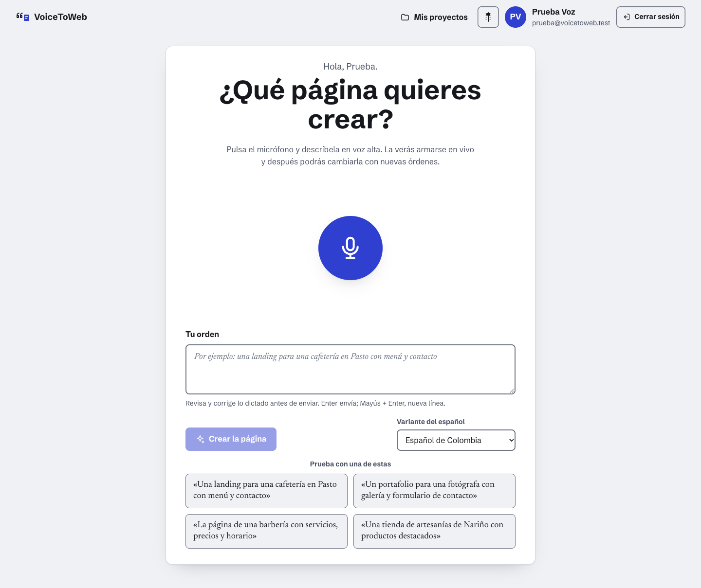
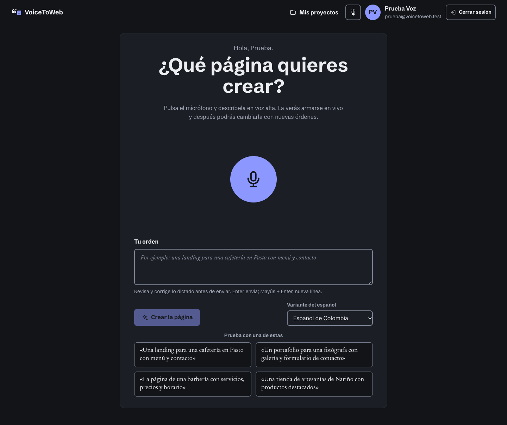
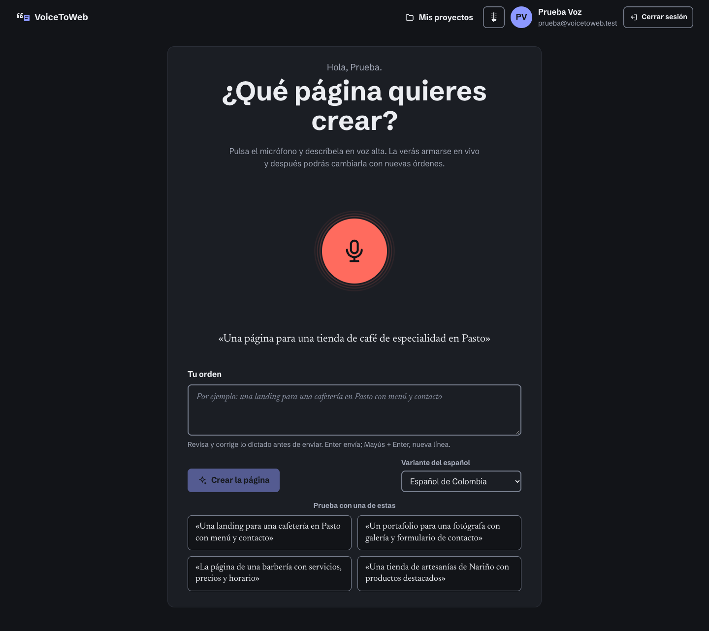
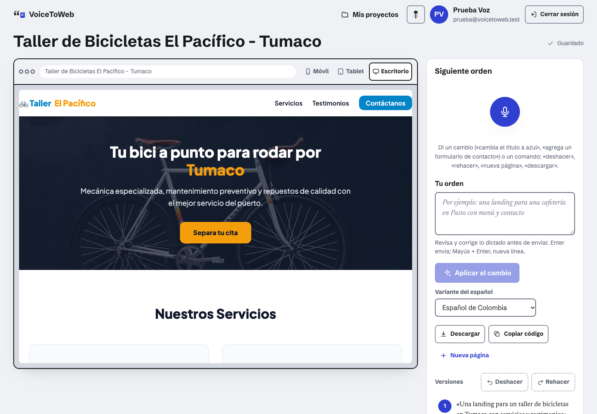
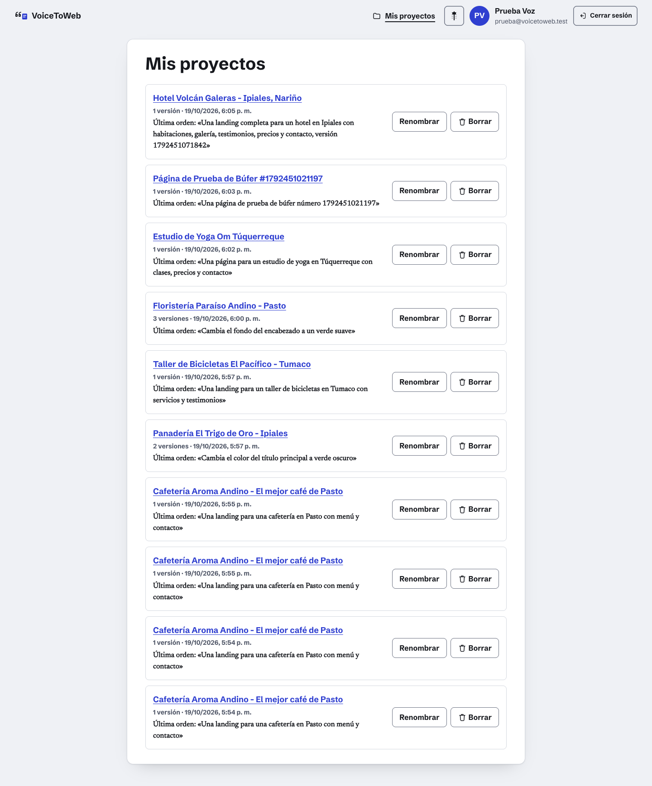

# VoiceToWeb · Frontend

**VoiceToWeb** es una herramienta de prototipado web por voz: describes en voz alta la página que quieres, la IA genera el HTML y CSS y lo muestra en vivo, y nuevas órdenes ("cambia el título a azul", "agrega un formulario de contacto") la modifican. Usa la Web Speech API del navegador, siempre con alternativa de teclado.

Proyecto 3 de la materia Programación orientada a la web. Angular 22 (standalone, signals, sin SSR, CSS plano).

Backend: <https://github.com/nicolaswagimin/pow-proyecto3-backend>

## Qué hace

1. **Dictas la página** con el gran micrófono de `/app`: los anillos siguen el volumen real y la transcripción aparece palabra por palabra, en español de Colombia por defecto. La revisas y la envías. Sin Web Speech API (Firefox), la escribes.
2. **La ves armarse en vivo** en una ventana de navegador, por bloques (encabezado, secciones, pie), con el progreso visible. Se puede ver a ancho de móvil, tablet o escritorio.
3. **La cambias con la voz:** «cambia el título a azul», «agrega un formulario de contacto». Lo que cambió se resalta un momento.
4. **Vuelves a cualquier versión,** deshaces y rehaces, por voz o con botones: «deshacer», «rehacer», «nueva página», «descargar».
5. **Se guarda sola** en tus proyectos, con todas sus versiones. La descargas como HTML o copias el código.

La vista previa es un iframe **sin ningún permiso** con la página saneada: el HTML que genera la IA nunca se ejecuta.

## Capturas

| | Claro | Oscuro |
|---|---|---|
| `/app` antes de la primera orden |  |  |
| `/app` con una página |  |  |
| `/app`, móvil |  |  |
| Acceso, escritorio |  |  |
| Acceso, móvil |  |  |







El acceso es una demostración del producto: un guion se dicta solo y cada frase confirmada convierte un bloque de maqueta en el componente real.

## Requisitos

- Node.js 22.22.3+ o 24.15+ (lo exige Angular 22). En Vercel: *Settings → Build and Deployment → Node.js Version* en 22.x o superior.
- El backend corriendo en <http://localhost:3003>.
- Para dictar: Chrome, Edge o Safari con micrófono (Firefox no soporta la Web Speech API; ahí se usa el teclado).

## Correr en local

```bash
npm install
npm start          # ng serve en http://localhost:4203
```

El puerto está fijo en `angular.json`, así los tres proyectos pueden correr a la vez (desde la carpeta raíz, `./demo.sh` arranca todo).

Las pruebas:

```bash
npm test           # 114 pruebas con Vitest y jsdom
```

Para compilar la versión de producción:

```bash
npm run build      # genera dist/pow-proyecto3-frontend/browser
```

## Rutas

| Ruta | Qué muestra |
|---|---|
| `/` | Redirige a `/app` si hay sesión, o a `/login` si no. |
| `/login` | Inicio de sesión que se arma por dictado; el correo se puede dictar. |
| `/registro` | Crear cuenta. Comparte componente con `/login`: el campo nombre se agrega por dictado. |
| `/app` | Protegida. El estudio: micrófono, orden, ventana con la página, versiones y acciones. `?proyecto=<id>` abre uno guardado. |
| `/proyectos` | Protegida. Proyectos guardados: abrir, renombrar y borrar. |
| `/design` | Guía de estilo viva: tokens, transcripción, bloque de maqueta y componentes. |

## Entornos (URL del backend)

| Archivo | Se usa con | `apiUrl` |
|---|---|---|
| `src/environments/environment.development.ts` | `ng serve` (local) | `http://localhost:3003/api` |
| `src/environments/environment.ts` | `ng build` (producción) | `https://pow-proyecto3-backend.onrender.com/api` |

## Desplegar en Vercel

1. Despliega primero el backend en Render como `pow-proyecto3-backend`.
2. En <https://vercel.com> crea un **New Project** e importa este repositorio.
3. Configura **Framework Preset:** Angular, **Build Command:** `npm run build`, **Output Directory:** `dist/pow-proyecto3-frontend/browser`.
4. Agrega la URL de Vercel a `FRONTEND_URL` del backend en Render (sin `/` final) para que CORS la permita.

`vercel.json` reescribe todas las rutas a `/index.html`, así que recargar `/login` o `/app` no da 404.

## Documentación

| Documento | Contenido |
|---|---|
| [docs/brief-diseno.md](docs/brief-diseno.md) | Concepto "Toma de dictado", demostración del login, direcciones descartadas |
| [docs/design-system.md](docs/design-system.md) | Tokens de color (con contraste), tipografía, espaciado, radios, sombras y movimiento |
| [docs/componentes.md](docs/componentes.md) | Cada componente con sus inputs, outputs y estados |
| [docs/animaciones.md](docs/animaciones.md) | Qué comunica cada animación y cómo se reduce |
| [docs/funcionalidades.md](docs/funcionalidades.md) | Todo lo que hace el estudio y los mensajes de error |
| [docs/voz.md](docs/voz.md) | Web Speech API (es-CO y variantes), comandos, Web Audio, compatibilidad y alternativa |
| [docs/vista-previa.md](docs/vista-previa.md) | Saneado, iframe sin permisos, CSP y descarga |
| [docs/versiones.md](docs/versiones.md) | Versiones en árbol, deshacer y rehacer, línea de tiempo y guardado |
| [docs/accesibilidad.md](docs/accesibilidad.md) | Decisiones de accesibilidad y resultado de axe |
| [docs/arquitectura-frontend.md](docs/arquitectura-frontend.md) | Carpetas, rutas, servicios, flujo de una página y pruebas |
| [docs/decisiones/](docs/decisiones/) | ADR: login armado por dictado, Web Speech API con teclado, dos familias tipográficas, movimiento que cuenta la voz, volumen real, iframe sin permisos, versiones en árbol, construcción en vivo |
| [CHANGELOG.md](CHANGELOG.md) | Cambios agrupados |

## Estructura

```
src/
  styles/tokens.css     todos los tokens de diseño
  app/core/             sesión, guards, interceptor, tema, errores, fortaleza
  app/voz/              VozService, NivelMicrofono, comandos, correoHablado, Dictado y ui-transcripcion
  app/vista-previa/     saneado y ui-ventana (iframe sin permisos)
  app/estudio/          bloques, versiones, EstudioEstado y los componentes del estudio
  app/services/         páginas (stream) y proyectos
  app/ui/               componentes base
  app/layouts/          auth-layout (guion y maqueta) y barra
  app/pages/            acceso, inicio (/app), proyectos y guía (/design)
```
